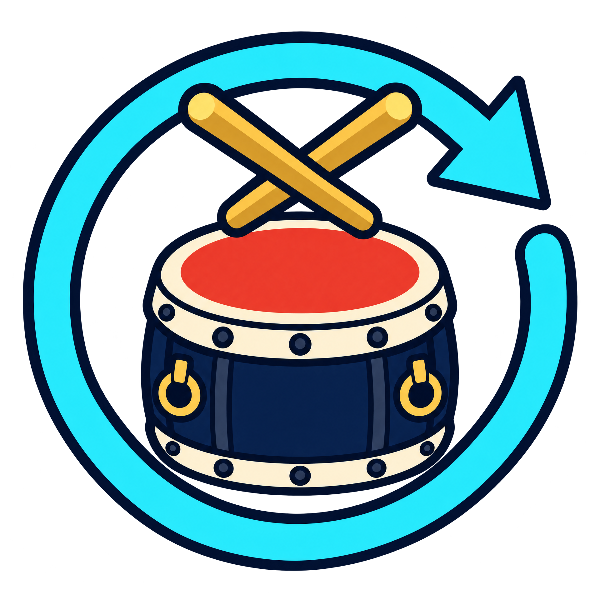

# TJA譜面同期



GitHub上の共有リポジトリからTJA形式の譜面データを取得し、指定した譜面フォルダへ同期するWindowsアプリです。アプリを起動している間、新しい譜面や更新を定期的に確認します。

本アプリは特定のシミュレーターの公式ツールではありません。ゲーム本体や実行ファイルを改変せず、利用者が指定した譜面フォルダへ譜面データを配置します。利用前に、利用するプレイヤーのDiscordで案内されているルールを確認してください。

## ダウンロードとインストール

1. このアプリのGitHubリポジトリで **Releases** を開き、最新リリースを選びます。
2. 添付されている `TJA-Chart-Sync-Setup.exe` をダウンロードして実行します。
3. 画面の案内に従ってインストールします。Pythonや追加ライブラリは不要です。
4. インストール完了後にアプリを起動します。

新しいReleaseでは、既存バージョンからの更新互換性のため `TaikoNautsZipSync-Setup.exe` も同じインストーラーの旧名として添付します。通常は新しい `TJA-Chart-Sync-Setup.exe` を選んでください。コード署名のないアプリのため、Windows SmartScreenが警告する場合があります。必ずこのリポジトリのReleaseから取得したファイルであることを確認してください。

## 初回設定

1. **譜面の保存先**の「参照...」から、プレイヤーが読み込む譜面フォルダを選びます。
2. GitHubユーザー・リポジトリ・ブランチ・ZIPフォルダは共有譜面用に初期設定されています。通常は変更不要です。
3. **今すぐ同期**を押します。`category.def`、カテゴリーの `box.def`、譜面ZIPが保存先へ反映されます。
4. 問題なく同期できたら、**Windows起動時に自動起動（タスクトレイ常駐・自動同期）**にチェックします。

共有譜面リポジトリはPublicなので、GitHubトークンの入力は不要です。

## 使い方

アプリを起動している間、設定した間隔で共有リポジトリを確認します。ウィンドウ右上の **×** は終了ではなく、タスクトレイへ隠す操作です。トレイアイコンを右クリックすると、ウィンドウ表示・今すぐ同期・終了を選べます。同期を止めるときはトレイメニューの **終了** を選んでください。

アプリの起動時にGitHub Releaseの最新版も確認します。更新がある場合は、確認ダイアログからこのアプリのGitHub Releaseにあるインストーラーをダウンロードして起動できます。利用者が承認するまでは更新を開始しません。手動確認は **アプリの更新を確認** ボタンから行えます。

PCの電源が切れている間は同期しません。次回起動時に自動起動が有効なら、起動後に確認します。

## お知らせ通知

譜面リポジトリに新しいお知らせが公開されると、アプリの次回同期確認時にWindows通知が表示されます。通知を受け取るにはアプリが起動中で、Windows側の通知が有効になっている必要があります。通知確認も設定した同期間隔に従います。

通知を受け取る利用者側にGitHubトークンや追加設定は不要です。お知らせの作成・公開は、別配布の管理者用ツールで行います。

## 譜面フォルダの構成

共有リポジトリ内の `charts` フォルダを指定した譜面フォルダへ同期します。各ZIPには一曲分の `.tja` と対応する音源を入れ、ZIP内のルートにファイルを置きます。ZIP名が曲フォルダ名になります。

```text
charts/
├── category.def
├── 01.Pops/
│   ├── box.def
│   └── 曲A.zip
└── 02.Kids/
    ├── box.def
    └── 曲B.zip
```

この例では `category.def` が譜面フォルダ直下へ、カテゴリーごとの `box.def` が各カテゴリー直下へ置かれます。曲ZIPは `01.Pops/曲A/` や `02.Kids/曲B/` に展開されます。

同じパス・同じ名前のZIPが更新された場合、対応する曲フォルダをZIPの内容で置き換えます。古い版にしかないファイルは残りません。ZIPをリポジトリから削除しても、プレイヤー側の譜面は自動削除されません。

## 困ったとき

同期に失敗した場合は、アプリの **ログファイルを開く** を押してください。ログは `%USERPROFILE%\TaikoNautsZipSync.log` にあります。既存利用者との互換性を保つため、ログファイル名は変更していません。ZIP内に同じファイル名（Windowsで大文字・小文字の違いだけの名前を含む）が重複している場合、そのZIPは展開されず、エラーがログに記録されます。

## 譜面・音源について

このアプリは共有リポジトリの内容を配布します。アップロードする人は、譜面・音源を共有・再配布してよいか各自で確認してください。
